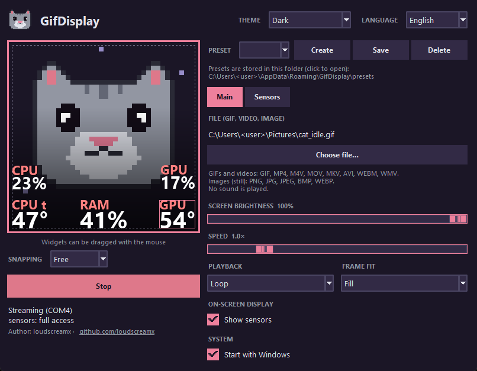

<div align="center">


# GifDisplay

**Software for the LCD display of the Jungle Leopard AstroShel ARGB 360 liquid cooler**

Display your own GIF animations, videos, images and live system sensor readings on the 320×320 LCD.

[Русская версия](README.ru.md) · [Releases](https://github.com/loudscreamx/GifDisplay/releases)


</div>



## Features

- **Any picture on the screen** – GIF, MP4/M4V/MOV/MKV/AVI/WEBM/WMV video, or a still PNG/JPG/BMP/WEBP.
- **Frame fit** – *Fill* (crop), *Fit* (black bars), *Stretch*, *Center* (no scaling). Loop or ping-pong playback, speed 0.5–3×.
- **Live sensor widgets** drawn over the picture: CPU / GPU temperature, load, power, clock, RAM, fans, pump, coolant, network speed.
  Drag them with the mouse, optional grid snapping, per-widget font, size, colors, shadow, warning color above a threshold.
- **Presets as plain files** – copy a `.json` preset to a friend and it shows up in the list.
- **Brightness** with proper gamma, a safe margin from the screen edge, edge shading for readable text.
- **Tray icon**, optional *start with Windows* that does **not** show a UAC prompt on every boot (uses a scheduled task).
- **Dark / light / follow-system theme**, 13 interface languages (switch in the header, the app restarts itself):
  English, Русский, Українська, Deutsch, Français, Español, Italiano, Português, Polski, Türkçe, 简体中文, 日本語, 한국어.

> **System:** Windows 10/11, 64-bit.
>
> **Tested on:** Jungle Leopard AstroShel ARGB 360 (its display shows up as USB `1F3A:0007`, 320×320, H.264 over a USB serial port; the vendor app is "Smart Screen V28").
> Other coolers with the same display and the same vendor app should work, but only this model has been tested. Screens with another USB ID or resolution are not supported.

**Is my screen supported?** Open GifDisplay and click *Diagnostics* (bottom left): it shows whether the display was found, the USB IDs of your COM ports and the ffmpeg version. The report can be copied with *Copy*.

## Install

Download `GifDisplay-Setup-<version>.exe` from the [Releases](https://github.com/loudscreamx/GifDisplay/releases) page and run it.
Windows may show a "publisher unknown" SmartScreen warning because the installer is not code-signed.

GifDisplay asks for administrator rights on start: reading CPU / board sensors needs a driver.
The installer offers the [PawnIO](https://pawnio.eu) driver as a separate checkbox (it is pre-ticked when PawnIO is not installed yet). Without it, CPU temperature, fan, pump and coolant readings are unavailable; load, memory, NVIDIA GPU, network, clock and date work anyway.
To install it later: download `PawnIO_setup.exe` from [PawnIO.Setup](https://github.com/namazso/PawnIO.Setup/releases/latest).
Close the vendor's Smart Screen program first – only one program can own the display's COM port.

## Run from source

```powershell
py -3.12 -m pip install -r requirements.txt
# put an ffmpeg build with libx264 at ffmpeg\ffmpeg.exe (e.g. from https://github.com/BtbN/FFmpeg-Builds)
py -3.12 app.py
```

Build the installer (needs [Inno Setup 6](https://jrsoftware.org/isinfo.php)):

```powershell
py -3.12 -m pip install pyinstaller
powershell -ExecutionPolicy Bypass -File installer\get_redist.ps1   # official PawnIO installer, checked by hash and signature
py -3.12 -m PyInstaller GifDisplay.spec --noconfirm
ISCC installer\GifDisplay.iss      # -> installer\output\GifDisplay-Setup-1.0.0.exe
```

## How it works

The display shows an H.264 stream sent over a USB CDC serial port. Packets look like
`5A A5 <cmd> 00 <len:u32 LE> <payload>`; `0x81` hello, `0x90` resolution query, `0x80` brightness, `0x85` one H.264 access unit
(Constrained Baseline, one slice, no B-frames). GifDisplay decodes the media with `ffmpeg`, draws the widgets with Pillow,
encodes with libx264 (`veryfast`, 30 fps) and writes the frames to the port.

## Translations

Interface strings use the Russian source text as the key; translations live in `locales/<code>.json`, generated from the
table in `tools/build_locales.py`. To fix a string or add a language, edit the table (and `LANGS` in `i18n.py`), then run
`py tools/build_locales.py`. The translations were written without a native-speaker review.

## License

MIT, see [LICENSE](LICENSE). Bundled third-party components (FFmpeg – GPL, LibreHardwareMonitorLib – MPL 2.0, …) are listed in
[THIRD_PARTY_NOTICES.md](THIRD_PARTY_NOTICES.md). Not affiliated with the display's vendor.
