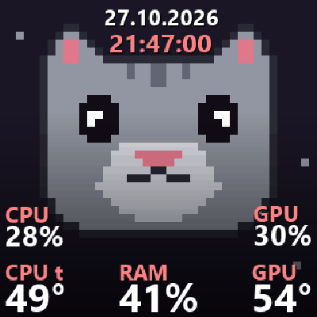
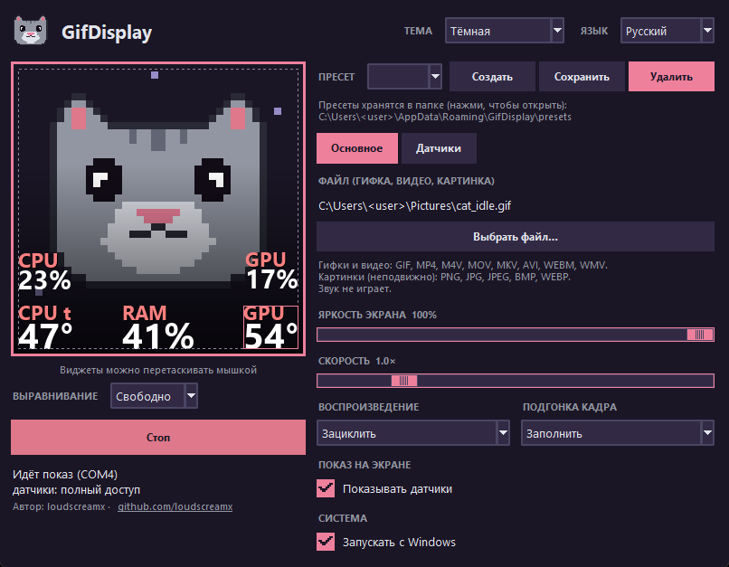

<div align="center">


# GifDisplay

**Программа для LCD-дисплея системы водяного охлаждения Jungle Leopard AstroShel ARGB 360**

Отображение собственных GIF-анимаций, видео, изображений и показаний системных датчиков на LCD-дисплее 320×320.

[English version](README.md) · [Releases](https://github.com/loudscreamx/GifDisplay/releases)



</div>



## Возможности

- **Любая картинка на экране** – GIF, видео (MP4, M4V, MOV, MKV, AVI, WEBM, WMV) или неподвижная PNG/JPG/BMP/WEBP.
- **Подгонка кадра** – «Заполнить» (с обрезкой), «Вписать» (чёрные поля), «Растянуть», «По центру» (без масштабирования).
  Зацикливание или «туда-обратно», скорость 0,5–3×.
- **Живые датчики поверх картинки**: температура, загрузка, мощность и частота CPU/GPU, память, кулеры, помпа, жидкость, сеть.
  Перетаскиваются мышью, есть привязка к сетке, у каждого свой шрифт, размер, цвета, тень и цвет предупреждения по порогу.
- **Пресеты обычными файлами** – скопируйте `.json` другу, и пресет появится в его списке.
- **Яркость** с учётом гаммы, отступ от края экрана, затемнение края для читаемости текста.
- **Значок в трее** и необязательный автозапуск, который **не** показывает окно UAC при каждой загрузке (через планировщик заданий).
- **Тёмная, светлая и «как в системе» темы**, 13 языков (выбираются в шапке окна, программа перезапускается сама):
  English, Русский, Українська, Deutsch, Français, Español, Italiano, Português, Polski, Türkçe, 简体中文, 日本語, 한국어.

> **Система:** Windows 10/11, 64 бит.
>
> **Проверено на:** Jungle Leopard AstroShel ARGB 360 (экран определяется как USB `1F3A:0007`, 320×320, H.264 по USB-последовательному порту; фирменная программа — «Smart Screen V28»).
> Другие системы охлаждения с таким же экраном и той же фирменной программой, скорее всего, заработают, но проверена только эта модель. Экраны с другим USB-идентификатором или разрешением не поддерживаются.

**Поддерживается ли мой экран?** Откройте GifDisplay и нажмите «Диагностика» (слева внизу): она покажет, найден ли экран, USB-идентификаторы COM-портов и версию ffmpeg. Отчёт можно скопировать кнопкой «Копировать».

## Установка

Скачайте `GifDisplay-Setup-<версия>.exe` на странице [Releases](https://github.com/loudscreamx/GifDisplay/releases) и запустите.
Windows может показать предупреждение SmartScreen «неизвестный издатель»: установщик не подписан сертификатом.

Программа при запуске просит права администратора: для чтения датчиков процессора и платы нужен драйвер.
Установщик предлагает драйвер [PawnIO](https://pawnio.eu) отдельной галочкой (она включена, если PawnIO ещё не установлен). Без него недоступны температура CPU, вентиляторы, помпа и температура жидкости; загрузка, память, видеокарта NVIDIA, сеть, часы и дата работают и так.
Установить позже: скачайте `PawnIO_setup.exe` на странице [PawnIO.Setup](https://github.com/namazso/PawnIO.Setup/releases/latest).
Фирменную Smart Screen сначала закройте: COM-порт экрана может занимать только одна программа.

## Запуск из исходников

```powershell
py -3.12 -m pip install -r requirements.txt
# положите сборку ffmpeg с libx264 в ffmpeg\ffmpeg.exe (например, https://github.com/BtbN/FFmpeg-Builds)
py -3.12 app.py
```

Сборка установщика (нужен [Inno Setup 6](https://jrsoftware.org/isinfo.php)):

```powershell
py -3.12 -m pip install pyinstaller
powershell -ExecutionPolicy Bypass -File installer\get_redist.ps1   # официальный установщик PawnIO, проверка хэша и подписи
py -3.12 -m PyInstaller GifDisplay.spec --noconfirm
ISCC installer\GifDisplay.iss      # -> installer\output\GifDisplay-Setup-1.0.0.exe
```

## Как это работает

Экран показывает поток H.264, который приходит по USB CDC (последовательный порт). Пакет: `5A A5 <cmd> 00 <длина u32 LE> <данные>`;
`0x81` приветствие, `0x90` запрос разрешения, `0x80` яркость, `0x85` один кадр H.264 (Constrained Baseline, один слайс, без B-кадров).
GifDisplay декодирует файл через `ffmpeg`, рисует виджеты Pillow, кодирует libx264 (`veryfast`, 30 к/с) и пишет кадры в порт.

## Переводы

Строки интерфейса в коде русские и служат ключами; переводы лежат в `locales/<код>.json` и собираются из таблицы
`tools/build_locales.py`. Чтобы поправить строку или добавить язык, отредактируйте таблицу (и `LANGS` в `i18n.py`) и запустите
`py tools/build_locales.py`. Переводы сделаны без проверки носителями языка.

## Лицензия

MIT, см. [LICENSE](LICENSE). Сторонние компоненты (FFmpeg – GPL, LibreHardwareMonitorLib – MPL 2.0 и др.) перечислены в
[THIRD_PARTY_NOTICES.md](THIRD_PARTY_NOTICES.md). Проект не связан с производителем экрана.
